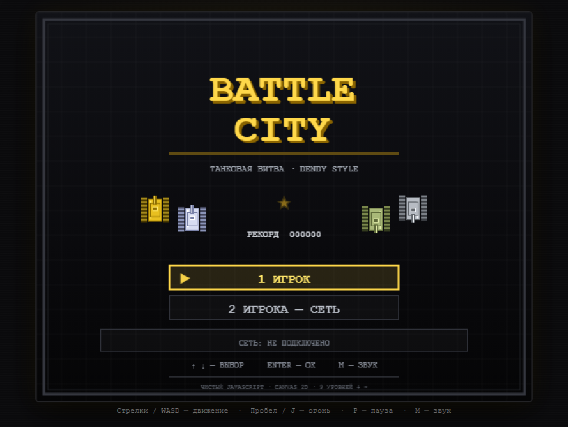
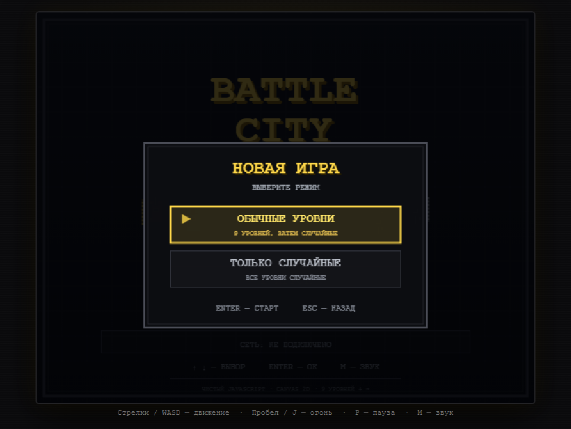
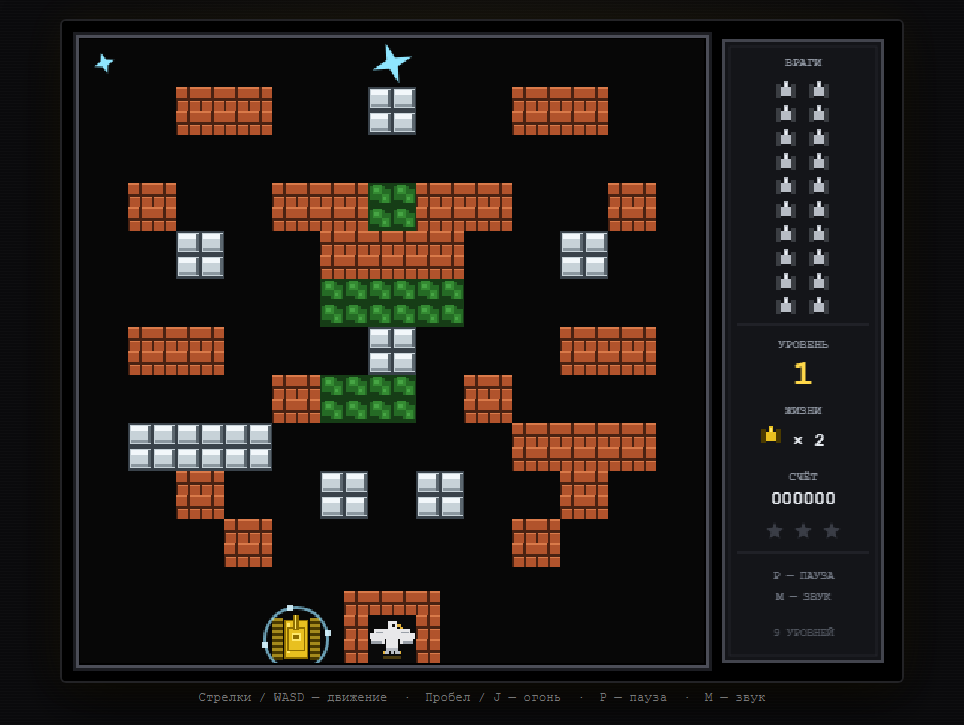
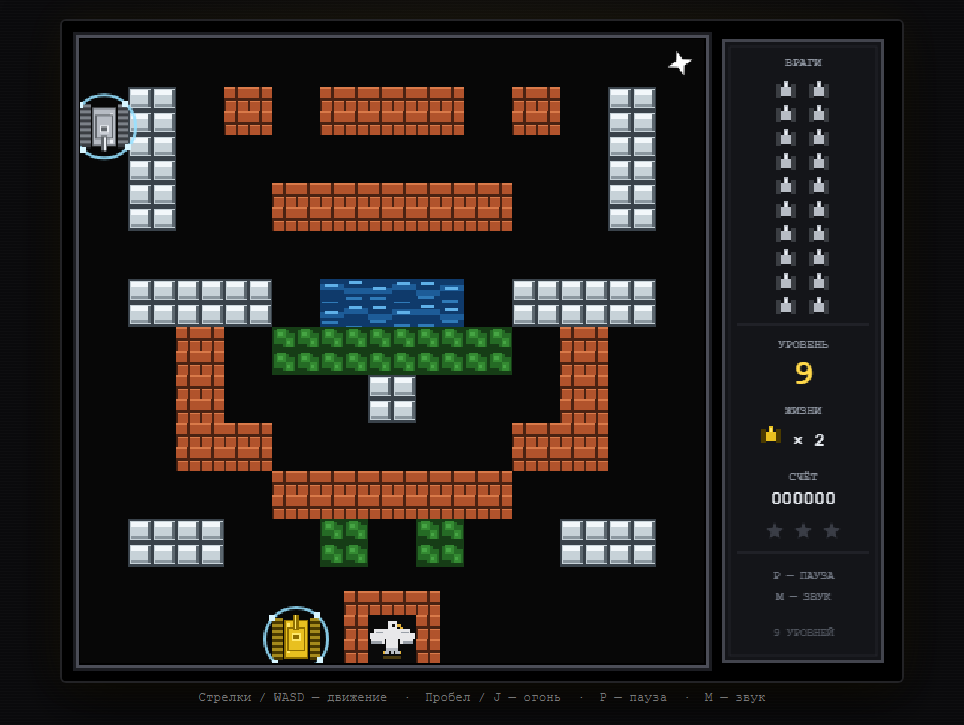
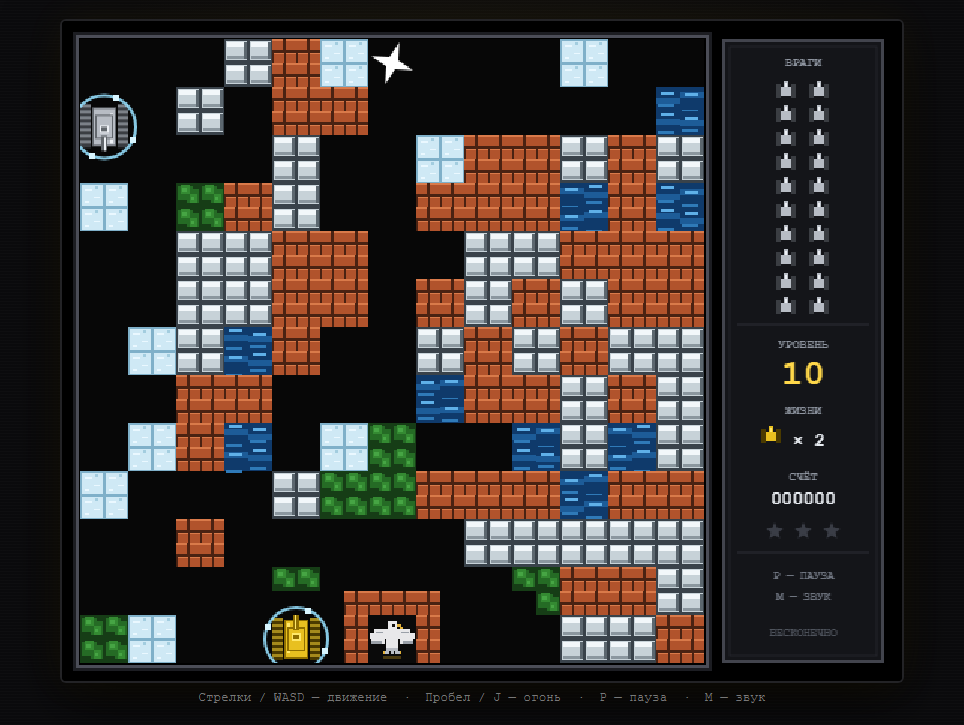
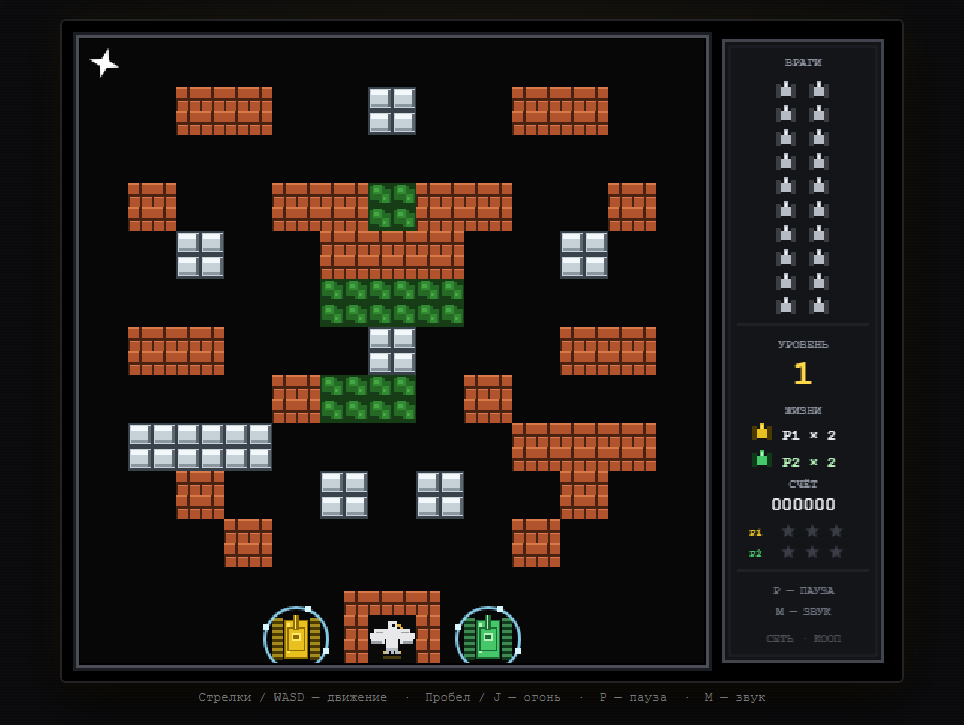

# Battle City — танковая аркада на чистом JavaScript

Клон классики Dendy: девять уровней, бесконечная процедурная генерация, бонусы и игра для двоих по локальной сети.
Без библиотек и внешних ассетов — только Canvas 2D, WebAudio и небольшой Node.js-сервер для сетевого режима.

**▶ Играть в браузере:** https://ormadont.github.io/battle-city-js/

> На GitHub Pages доступна одиночная игра. Сетевой режим требует запуска
> локального сервера (`server.js`) — см. раздел «Запуск».

## Скриншоты

| Меню | Выбор режима |
| --- | --- |
|  |  |
| **Уровень 1** | **Уровень 9** |
|  |  |
| **Сгенерированный уровень** | **Игра для двоих по сети** |
|  |  |

## Возможности

- **9 рукотворных уровней** с постепенным ростом сложности: больше противников,
  больше танков одновременно, больше бронированных целей.
- **Бесконечный режим**: после последнего уровня автоматически начинаются
  сгенерированные. Генератор гарантирует связную карту — от точек появления
  врагов всегда есть проезд к игрокам и базе.
- **Два режима новой игры**: «Обычные уровни» (9 уровней, затем случайные)
  и «Только случайные».
- **4 типа противников**: обычный, быстрый, мощный и бронированный (4 попадания).
- **6 бонусов**: звезда, граната, каска, лопата, часы, жизнь.
- **Игра для двоих по локальной сети**: хост-авторитетная синхронизация,
  обмен состоянием 30 раз в секунду, отдельные жизни и прокачка у каждого игрока.
- **Чистый JS**: вся графика рисуется на canvas, звук синтезируется через WebAudio.

## Управление

| Действие | Игрок 1 | Игрок 2 (сеть) |
| --- | --- | --- |
| Движение | Стрелки / WASD | Стрелки / WASD |
| Огонь | Пробел / J | Пробел / J |
| Пауза | P | P |
| Звук | M | M |
| Меню | Стрелки / W,S + Enter | — |

На тачскрине есть экранные кнопки.

## Запуск

Нужен [Node.js](https://nodejs.org/) 18 или новее.

**Windows, самый простой способ:** откройте папку `publish/battle-city-net`
и дважды щёлкните `start.cmd` — сервер запустится, игра откроется в браузере.

**Вручную из корня репозитория:**

```bash
node server.js --port 8080
```

и откройте http://localhost:8080/

### Сетевая игра на двух компьютерах

1. Запустите `server.js` (или `start.cmd`) на **обоих** компьютерах.
2. На каждом откройте страницу по его локальному IP, например
   `http://192.168.1.10:8080/`.
3. В меню выберите «2 ИГРОКА — СЕТЬ» и введите IP второго компьютера.
4. Когда у обоих появится статус «ПОДКЛЮЧЕНО», хозяин нажимает «НАЧАТЬ БОЙ».

Если связи нет: проверьте, что компьютеры в одной сети, порт совпадает,
а Node.js разрешён в брандмауэре Windows (частные сети).

## Публикация

- Репозиторий: https://github.com/Ormadont/battle-city-js (публичный).
- Игра на GitHub Pages: https://ormadont.github.io/battle-city-js/
- Источник сайта — ветка `main`, корень репозитория. Любой push в `main`
  автоматически пересобирает Pages за 1–2 минуты.
- На Pages работает только одиночная игра: сетевой режим требует запуска
  локального сервера (см. раздел «Запуск»).

## Тесты

```bash
node test/levels.js      # параметры, сложность и проходимость всех уровней + 300 сгенерированных карт
node test/drive.js       # браузерный прогон: меню, режимы, кампания, бонусы, бой (нужен Chrome)
node test/net-server.js  # логика сетевого сервера
node test/net-e2e.js     # два браузера и два сервера: рукопожатие и совместная игра
```

`test/levels.js` проверяет, что каждый уровень проходим для танка 32×32
(от игроков достижимы все точки появления врагов и подход к базе),
что параметры не выходят за лимиты (например, противников от 1 до 30)
и что сложность уровней не убывает.

## Структура

```
index.html, style.css     — страница и оформление
js/game.js                — игровая логика, режимы, сеть на стороне игры
js/levels.js              — девять уровней
js/gen.js                 — генератор случайных уровней
js/net.js                 — связь с сервером и панель ввода IP
js/audio.js               — синтезированный звук (WebAudio)
server.js                 — HTTP-сервер и WebSocket-ретранслятор для сетевой игры
test/                     — автотесты
publish/battle-city-net/  — готовая сборка с start.cmd и README
shots/                    — скриншоты
```
